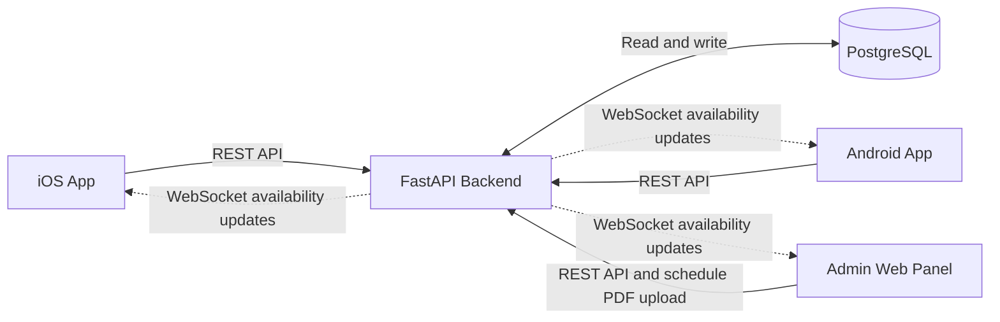

# AITU Booking

AITU Booking is a diploma project for Astana IT University. It is a mobile system for booking study rooms and lecturer consultations, with room availability updates in real time.

Students will select a building and floor, find a room on an interactive map, and choose a time slot. A web administration panel will support schedule management and key tracking.

**Academic year:** 2026–2027  
**Current stage:** Analysis, requirements, architecture, and interface design

## Problem statement

Students may need to check schedules and contact staff separately to find an available study room. Consultations may also be arranged through personal messages. These processes make it difficult to see available options in one place and can lead to scheduling conflicts.

The project aims to provide a single system for viewing availability, making reservations, and managing university rooms and consultation slots.

## Team

| Team member | Group | Responsibilities |
| --- | --- | --- |
| Adilbek Arman | SE-2411 | Mobile development, interactive room map, UI/UX design |
| Maksat Sugirov | SE-2404 | FastAPI backend and database |
| Aizat Kydyrkhan | SE-2408 | Web administration panel and UI/UX design |

**Supervisor:** Omirzak Islam Amanzholuly

## Target users

- **Students** find rooms, make and cancel reservations, and book consultations.
- **Lecturers** manage consultation slots and view student bookings.
- **Administrators** manage schedules and rooms, review imported data, and track the issue and return of keys.

## Project scope

The initial development stage focuses on room booking through the interactive map, the iOS application, schedule management, and the web administration panel. Consultation booking and the Android application are planned as subsequent stages of the diploma project.

A complete application is not required for the first pre-defense. This stage focuses on research, requirements, comparisons, architecture, interface designs, verification planning, and a traceable record of team contributions.

## Planned functionality

### Room booking

- Select a building and floor, then tap a room on the interactive map.
- View available time slots and create a reservation without typing the room number.
- Allow reservations starting between **1 and 72 hours** after the request.
- Prevent reservations that overlap classes or other confirmed bookings.
- Allow cancellation of a room reservation before it starts.
- Update availability when a reservation is created or cancelled.

### Schedule and key management

- Import the class schedule from a PDF file and preview the extracted entries before confirming them.
- Support the regular schedule for weeks 1–10 and a separate examination schedule for weeks 11–12.
- Allow administrators to add or correct schedule entries manually.
- Record key issue and return, including the required signature and university ID-card deposit.
- Display keys that have not been returned.

### Consultation booking

- Allow lecturers to publish available consultation slots.
- Allow students to book a free slot.
- Prevent two students from booking the same slot.
- Allow a student to cancel at least one hour before the consultation starts.

## Proposed system components

| Component | Proposed technology | Purpose |
| --- | --- | --- |
| iOS application | Swift, SwiftUI | Mobile interface and interactive room map for iPhone |
| Android application | Kotlin, Jetpack Compose, Android SDK | Mobile interface and interactive room map for Android devices |
| Backend | Python, FastAPI | API, booking rules, schedule processing, and authorization |
| Database | PostgreSQL | Rooms, schedules, users, consultations, and reservations |
| Administration panel | Web application | Schedule import, room management, and key tracking |
| Live updates | WebSocket | Deliver booking and availability changes to connected clients |

These choices are discussed in the technology comparison. The backend and database will enforce booking rules so simultaneous requests cannot confirm overlapping reservations.

## Repository structure

```text
admin-web/    Web administration panel
android/      Android application (Kotlin and Jetpack Compose)
backend/      FastAPI application, database models, migrations, and tests
ios/          iOS application (Swift and SwiftUI)
docs/         Research, comparisons, requirements, architecture, UX designs, plans, and feedback
  diagrams/   Editable diagram sources and readable exports
  ux/         Exported interface screens
prototype/    Interface designs or links to design files
tests/        Test plans and supporting test materials
```

Each directory will be populated as its corresponding tasks are completed. Configuration examples will use placeholder values; passwords and API keys must not be committed.

## Architecture

The system is designed as a client–server application. The iOS application, the planned Android application, and the web administration panel communicate with a FastAPI backend. PostgreSQL stores users, rooms, schedules, reservations, consultation slots, and key records.



The backend is planned as one application with separate modules for authentication, rooms, schedules, reservations, consultations, and key tracking.

A booking request is checked against class schedules and existing reservations. The backend confirms it only if the requested interval is available. Database-level protection is planned to prevent two simultaneous requests from confirming overlapping reservations for the same room.

Administrators will preview extracted schedule entries before confirming an import. Booking changes will be sent to connected clients through WebSocket events so they can refresh room availability.

The detailed [System Context, Use Case, and Component diagrams](docs/diagrams/) and the [architecture description](docs/07-architecture.md) are maintained separately.

## Project documentation

### Research and decisions

1. [Project proposal and scope](docs/01-project-proposal.md)
2. [Evidence of relevance and user research](docs/02-evidence-of-relevance.md)
3. [Literature review and publication analysis table](docs/03-literature-review.md)
4. [Existing systems comparison](docs/04-existing-systems.md)
5. [Technology comparison](docs/05-technology-choice.md)

### Requirements and design

6. [Functional and non-functional requirements](docs/06-requirements.md)
7. [Architecture description](docs/07-architecture.md)
8. [System Context, Use Case, and Component diagrams](docs/diagrams/)
9. [UX designs and key user scenarios](docs/08-ux-design.md)

### Evaluation and management

10. [Verification and evaluation plan](docs/09-evaluation-plan.md)
11. [Milestones, responsibilities, dependencies, and risks](docs/10-project-plan.md)
12. [Supervisor feedback and resulting revisions](docs/11-supervisor-feedback.md)

The [diagrams directory](docs/diagrams/) contains both editable PlantUML sources and readable PNG/SVG exports. The [UX document](docs/08-ux-design.md) includes the exported mobile screens from [docs/ux/screens/](docs/ux/screens/).

## Project tracking and contributions

Tasks, owners, deadlines, expected outcomes, and acceptance criteria are tracked in [YouTrack](https://aitu-booking.youtrack.cloud/).

Each completed task should link to the corresponding document, commit, or pull/merge request. Development work is recorded progressively using individual team accounts. And will be shown in a document with submission.

## Project links

- [YouTrack task board](https://aitu-booking.youtrack.cloud/agiles/204-1/current)
- [Figma design](https://www.figma.com/design/VDu3NBrZE9RSqq8gShbb71/AITU-Booking-%E2%80%94-Pre-defense-prototype?node-id=0-1&p=f&t=ibV3acw12wivs0yX-0)

## First pre-defense submission

The exact submitted version will be marked with the Git tag `pre-defense-1`. The submission will include a summary of completed work, known limitations, and outstanding tasks. Development will continue in the same repository after the pre-defense.

## Setup and testing

Component-specific setup, execution, and testing instructions will be added as runnable code becomes available.
