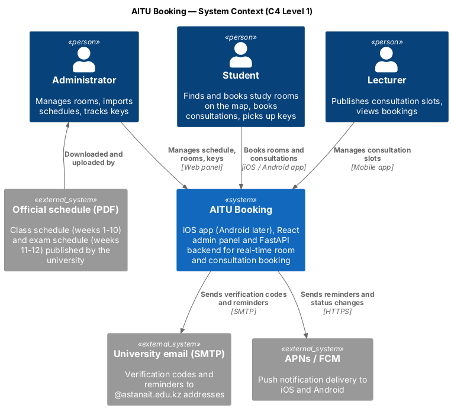
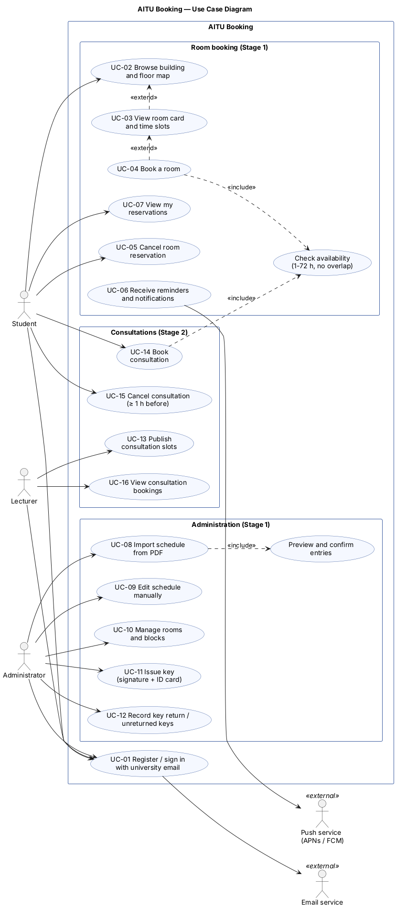
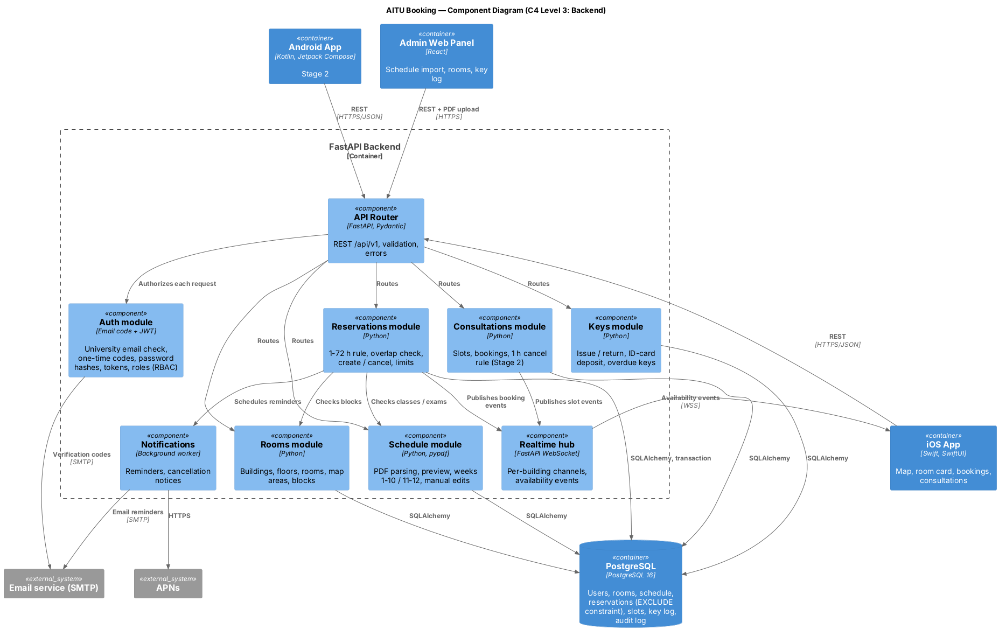
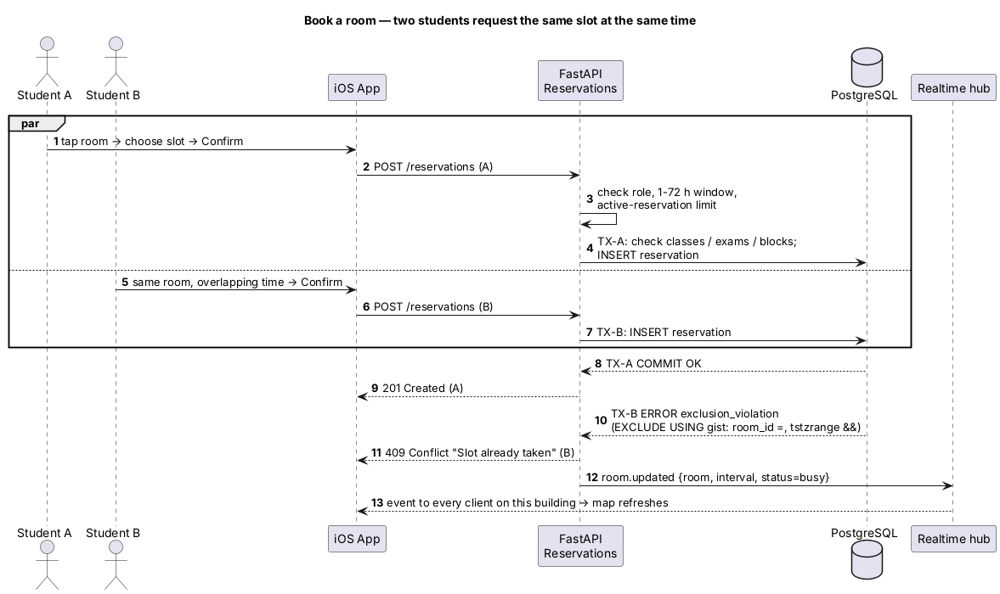

# Diagrams

Editable sources are in [`src/`](src/) (PlantUML). Readable exports are in [`export/`](export/) as PNG and SVG.

| # | Diagram | Source | Export |
|---|---|---|---|
| 1 | System Context (C4 Level 1) | [01-system-context.puml](src/01-system-context.puml) | [PNG](export/system-context.png) · [SVG](export/system-context.svg) |
| 2 | Use Case | [02-use-case.puml](src/02-use-case.puml) | [PNG](export/use-case.png) · [SVG](export/use-case.svg) |
| 3 | Component (C4 Level 3, backend) | [03-component.puml](src/03-component.puml) | [PNG](export/component.png) · [SVG](export/component.svg) |
| 4 | Sequence: concurrent room booking | [04-booking-sequence.puml](src/04-booking-sequence.puml) | [PNG](export/booking-sequence.png) · [SVG](export/booking-sequence.svg) |

## System Context



## Use Case



Use case IDs (UC-01 … UC-16) are referenced in the [requirements](../06-requirements.md) traceability table.

## Component



## Sequence: concurrent room booking



## Exporting

Diagrams are written in PlantUML. To update an export after editing a source:

```bash
java -jar plantuml.jar -tpng -o ../export src/*.puml
java -jar plantuml.jar -tsvg -o ../export src/*.puml
```

The VS Code "PlantUML" extension can preview and export the `.puml` files as well.
